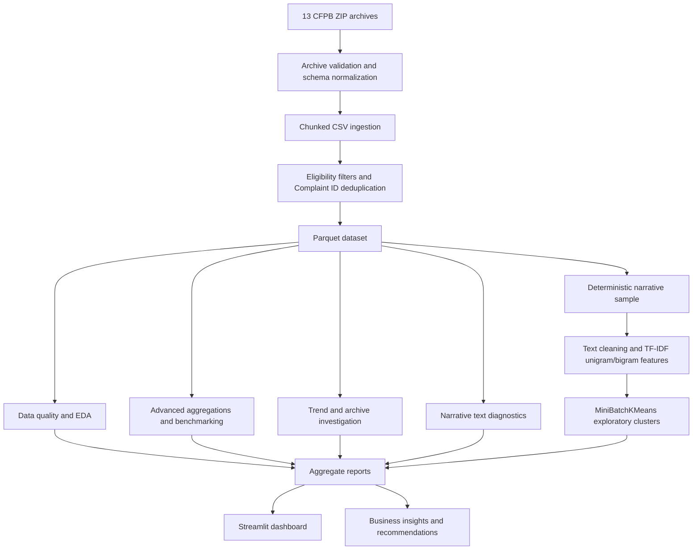

# Project Architecture

## Main components

| Component | Responsibility |
|---|---|
| `src/ingest_archives.py` | Validate ZIP archives, normalize fields, filter records, deduplicate IDs, write Parquet |
| `src/data_quality.py` | Profile schema, missingness, dates, duplicates, categories and narrative lengths |
| `src/eda.py`, `src/visualizations.py` | Exploratory summaries and charts |
| `src/advanced_analytics.py` | Company, product, issue, geographic and response aggregations |
| `src/trend_investigation.py` | Monthly screening and source archive/product reconciliation tables |
| `src/text_diagnostics.py` | Narrative length and normalized exact-repeat diagnostics without exporting raw text |
| `src/stage3_nlp.py` | Deterministic sample, text cleaning, TF-IDF, clustering and aggregate theme outputs |
| `app/dashboard_stage4.py` | Streamlit dashboard over generated aggregate reports |
| `tests/` | Unit tests for ingestion, data quality, analytics and NLP utilities |

## Data boundaries

Raw CFPB ZIP archives, complaint-level Parquet files, local SQLite indexes, and virtual environments are local working assets and must not be committed to a public repository. Commit source code, tests, configuration templates, methodology documentation, and carefully reviewed aggregate examples only. Never publish raw complaint narratives or sensitive row-level data.

## Execution order

1. Validate and ingest archives.
2. Run data quality, EDA and visualizations.
3. Run advanced analytics, trend investigation and text diagnostics.
4. Run the Stage 3 NLP pipeline.
5. Run tests.
6. Launch `streamlit run app/dashboard_stage4.py`.
